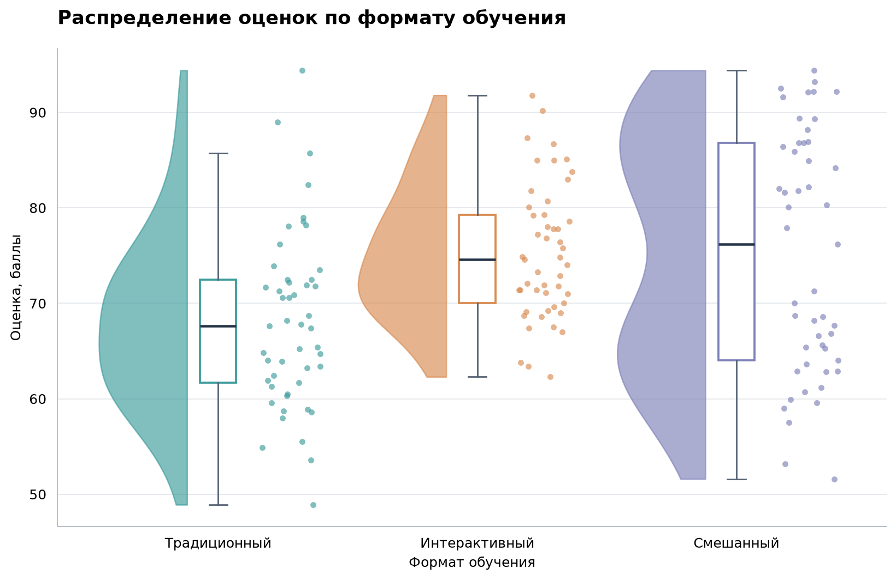

# RainView

Локальная Python-библиотека для сравнения распределений: один вызов объединяет
half-violin, boxplot и отдельные наблюдения. На входе — pandas DataFrame, на выходе —
Matplotlib Figure, Axes и словарь описательной статистики. Интерфейс и поведение
соответствуют техническому заданию команды.



## С чего начать

1. Посмотрите готовые рисунки в `demo_output/`.
2. Откройте `examples/01_quickstart.ipynb`: в ноутбуке уже сохранены результаты выполнения.
3. Для объяснения реализации используйте [docs/implementation.md](docs/implementation.md).
4. Результаты проверок находятся в [verification/REPORT.md](verification/REPORT.md).

### Запуск на этом компьютере

В папке проекта подготовлено окружение `.venv`, использующее установленные
зависимости Anaconda. Выполните в терминале:

```bash
cd /home/bottega_boy/Documents/5_semak/vanya
.venv/bin/python examples/make_figures.py
```

В `outputs/` появятся два рисунка в PNG/SVG и русская текстовая сводка.
Предупреждение о трёх пропусках ожидаемо: они специально включены в учебный CSV.

### Установка в новое окружение

Нужен Python 3.10 или новее. Из корня проекта:

```bash
python3 -m venv .venv
source .venv/bin/activate
python -m pip install -e ".[dev,notebooks]"
python examples/make_figures.py
```

Для использования только библиотеки достаточно `python -m pip install .`.
Готовый wheel находится в `dist/`; его тоже можно установить через pip.
Сама библиотека работает локально без сетевых запросов. При первой установке
недостающие зависимости pip обычно загружает из индекса пакетов.

## Минимальный пример

```python
import pandas as pd
import matplotlib.pyplot as plt
from rainview import raincloudplot, format_summary, save_plot

df = pd.read_csv("data/education.csv")
fig, ax, summary = raincloudplot(
    data=df,
    value="score",
    group="method",
    title="Оценки по формату обучения",
    x_label="Формат обучения",
    y_label="Баллы",
)

print(format_summary(summary))
save_plot(fig, "raincloud.png")
save_plot(fig, "raincloud.svg")
plt.show()
```

При чтении своего CSV используйте нужные `sep`, `decimal` и `encoding` в
`pd.read_csv`. Библиотека принимает готовую таблицу и не угадывает её формат.

Важная деталь: функция возвращает **три** объекта: `fig, ax, summary`.
В кратком примере бизнес-гипотезы указаны два; здесь принят уточнённый контракт
из Архитектуры.

## Параметры raincloudplot

| Параметр | По умолчанию | Назначение |
| --- | --- | --- |
| `data` | обязательный | pandas DataFrame с уникальными одноуровневыми именами столбцов |
| `value` | обязательный | имя столбца вещественных чисел |
| `group` | обязательный | имя столбца с метками групп |
| `title` | `None` | заголовок |
| `x_label`, `y_label` | имена столбцов | подписи осей рисунка |
| `palette` | `"Set2"` | палитра Matplotlib, список цветов или словарь `{группа: цвет}` |
| `figsize` | `(10, 6)` | ширина и высота в дюймах |
| `orientation` | `"vertical"` | `"vertical"` или `"horizontal"` |
| `point_alpha` | `0.6` | прозрачность точек от 0 до 1 |
| `point_size` | `20` | положительная площадь маркера в pt² |
| `show_box` | `True` | отображение boxplot |
| `show_points` | `True` | отображение всех отдельных наблюдений |
| `order` | `None` | все наблюдаемые группы без повторений в нужном порядке |
| `random_state` | `42` | неотрицательный seed для jitter; `None` — случайное смещение |

Дополнительные параметры передаются по имени. Порядок по умолчанию — первое
появление группы в таблице. Неиспользованные уровни pandas Categorical не рисуются.
`order` меняет порядок, но не фильтрует данные: для фильтрации сначала выберите строки DataFrame.
В горизонтальном графике X — измерения, Y — группы; подписи `x_label` и `y_label`
всегда относятся к физическим осям X и Y.

Вернувшийся `ax` можно настраивать обычным Matplotlib:

```python
ax.axhline(70, color="gray", linestyle="--", linewidth=1)
fig.savefig("with_reference.png", dpi=200, bbox_inches="tight")
```

После сохранения или просмотра освобождайте рисунок через `plt.close(fig)`, если
строите много графиков в цикле.

## Очистка и статистика

Строка исключается, если в `value` или `group` есть пропуск. Другие столбцы не
участвуют в очистке. Исходный DataFrame не меняется. Пропуски не заменяются
средним, строки с числами не преобразуются молча, бесконечности отклоняются с ошибкой.

`summary` содержит:

```python
{
    "total_rows": 150,
    "valid_rows": 147,
    "dropped_rows": 3,
    "missing_group_rows": 1,
    "groups": {
        "Традиционный": {
            "n": 49,
            "mean": ..., "median": ..., "min": ..., "max": ...,
            "std": ..., "q1": ..., "q3": ...,
            "dropped_rows": 1,
        },
        # остальные группы
    },
}
```

Ключи групп сохраняют исходный тип, например числа остаются числами. `std` —
выборочное стандартное отклонение (`ddof=1`). Квартили используют линейную
интерполяцию. Усы boxplot доходят до крайних наблюдений в пределах 1.5 IQR.
Если точки включены, выбросы уже находятся среди них; при выключенных точках
они показаны отдельными маркерами boxplot.

`dropped_rows` внутри группы учитывает только строки с известной меткой этой
группы и пропущенным измерением. Строки без метки учтены отдельно в
`missing_group_rows`. Поэтому общий счётчик равен сумме исключений по группам
плюс число строк без метки, без двойного подсчёта.

## Ошибки и предупреждения

Все ошибки RainView наследуют `RainViewError` и содержат русское сообщение.

| Класс | Причина |
| --- | --- |
| `ColumnNotFoundError` | нет обязательного столбца |
| `NonNumericColumnError` | строковый, логический, комплексный или другой нечисловой столбец |
| `EmptyGroupError` | в наблюдаемой группе после очистки не осталось значений |
| `InsufficientDataError` | после очистки в какой-либо группе меньше 5 наблюдений |
| `InsufficientGroupsError` | осталось меньше двух групп |
| `InvalidDataError` | неверный формат данных, повторные имена столбцов, бесконечности |
| `InvalidParameterError` | неверные параметры отображения или экспорта |

```python
from rainview import RainViewError

try:
    fig, ax, summary = raincloudplot(df, "score", "method")
except RainViewError as error:
    print(error)
```

Предупреждения не останавливают обычный запуск: `MissingDataWarning` сообщает об
исключённых строках, `SmallSampleWarning` — о 5–19 наблюдениях,
`ConstantGroupWarning` - о вырожденной плотности. Более 10 групп и более
100 000 строк вызывают `GroupCountWarning` и `LargeDatasetWarning` соответственно.
Таким образом, рекомендация «2–10 групп» не превращается в необоснованный запрет.

В постоянной группе half-violin заменяется линией на значении измерения; точки и
boxplot сохраняются. Для KDE измерения никогда не дополняются искусственным шумом.

## Экспорт

`save_plot(fig, path, dpi=180)` поддерживает PNG и SVG, возвращает `pathlib.Path`.
Папка назначения должна существовать; существующий файл будет перезаписан.
Рисунок остаётся открытым. Также доступен стандартный `fig.savefig(...)`.
`format_summary(summary)` возвращает строку; запись текстовой сводки выполняется
пользователем явно, например через `Path.write_text`.

## Примеры и проверка

- `examples/01_quickstart.ipynb` — CSV, график, пропуски, сводка и PNG/SVG.
- `examples/02_distributions_and_style.ipynb` — одинаковое среднее при разной форме,
  горизонтальный график, палитры и настройка Matplotlib.
- `examples/03_validation_and_reproducibility.ipynb` — ошибки, постоянные группы,
  сохранность данных и повторяемый jitter.

```bash
python -m pytest -q
python -m ruff check src tests scripts examples
python scripts/benchmark.py
python scripts/execute_notebooks.py
python -m build
```

Для выполнения ноутбуков нужны зависимости `notebooks`, для тестирования и
сборки — `dev`. Полный состав проверенного окружения приведён в
`verification/environment.txt`. Скрипт `execute_notebooks.py` временно регистрирует
ядро текущего интерпретатора только в своей временной папке.

## Структура

```text
src/rainview/          библиотека: API, данные, визуализация, отчёт, ошибки
tests/                автоматические проверки
data/                 искусственные CSV для воспроизводимых примеров
examples/             три выполненных ноутбука и скрипт демонстрации
demo_output/          готовые PNG/SVG и текстовая сводка
scripts/              выполнение ноутбуков и измерение производительности
docs/                 описание реализации и сценарий демонстрации
source_documents/     исходные документы команды
verification/         результаты проверки и параметры окружения
dist/                 установочные wheel и исходный архив пакета
```

## Как читать график

Плотность оценивается Gaussian KDE по правилу Скотта на сетке из 192 точек и
обрезается по минимуму и максимуму наблюдений. Максимальная ширина каждой группы
одинакова: сравнивайте форму распределений, а размер выборки смотрите в сводке.
Выбор ширины сглаживания влияет на вид плотности и может скрывать отдельные пики.
Значения отдельных наблюдений при jitter не меняются.

RainView не выполняет статистических тестов и не выводит, какой метод «лучше».
В MVP нет сервера, регистрации, облачного хранения и сбора пользовательских данных.

Технические источники: [Gaussian KDE в SciPy](https://docs.scipy.org/doc/scipy/reference/generated/scipy.stats.gaussian_kde.html),
[boxplot по готовым статистикам в Matplotlib](https://matplotlib.org/stable/api/_as_gen/matplotlib.axes.Axes.bxp.html),
[проверка числового типа в pandas](https://pandas.pydata.org/docs/reference/api/pandas.api.types.is_numeric_dtype.html).
