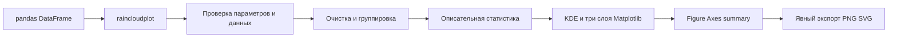

# Реализация RainView

RainView реализует три функции MVP из бизнес-гипотезы команды: построение
raincloud plot, настройку с проверкой данных, экспорт со сводкой. Публичная точка
входа `raincloudplot()` возвращает `(fig, ax, summary)` согласно уточнённой архитектуре.

## Поток данных

Состояние между вызовами не хранится. DataFrame не изменяется. Генератор jitter
создаётся внутри вызова и не затрагивает глобальный генератор NumPy. Функция не
вызывает `plt.show()` и не сохраняет файлы самостоятельно.

## Компоненты

| Файл | Ответственность |
| --- | --- |
| `src/rainview/__init__.py` | публичные функции, классы ошибок и версия |
| `src/rainview/_data.py` | валидация таблицы, очистка, группировка, статистика |
| `src/rainview/plotting.py` | параметры оформления, плотность, boxplot и точки |
| `src/rainview/reporting.py` | текстовая сводка и явное сохранение PNG/SVG |
| `src/rainview/exceptions.py` | общие исключения и предупреждения |

Используются pandas, NumPy, Matplotlib и SciPy. В архитектуре допускается
Seaborn или SciPy для плотности: выбран SciPy, поскольку слои и палитры уже
строятся Matplotlib и отдельная зависимость Seaborn не нужна.

## Алгоритм

1. Проверить параметры отображения и структуру таблицы. Отклонить отсутствующие
   и повторяющиеся столбцы, нечисловые значения, bool/complex, бесконечности.
2. Получить наблюдаемые метки групп через `pandas.factorize`, сохранив порядок
   первого появления. Неиспользованные категории не считать группами данных.
3. Исключить строки с пропусками в выбранных двух столбцах. Проверить, что ни одна
   наблюдаемая группа не опустела и в каждой осталось минимум пять измерений.
4. Проверить наличие минимум двух групп и полный порядок `order`, если он задан.
5. Рассчитать n, mean, median, min, max, std, q1, q3 и число исключений. Для std
   использовать `ddof=1`. Посчитать строки без метки группы отдельно.
6. Вычислить Gaussian KDE по правилу Скотта. Нормировать максимальную ширину
   каждой плотности до 0.34 шага категориальной оси. Ограничить сетку наблюдаемым
   диапазоном. Нормализация измерений перед KDE уменьшает численные проблемы.
7. Построить half-violin, boxplot с усами 1.5 IQR и все точки с воспроизводимым jitter.
8. Установить оси, подписи, заголовок и вернуть Figure, Axes и summary.

Минимум в пять наблюдений следует строгому контракту архитектуры. Порог
предупреждения в 20 наблюдений — конкретизация её рекомендации предупреждать о
малых выборках; это правило интерфейса, а не гарантия качества оценки плотности.

## Совмещение слоёв

Для группы с индексом i предусмотрены отдельные полосы категориальной оси:

| Слой | Координаты |
| --- | --- |
| half-violin | от i − 0.46 до i − 0.12 |
| boxplot | от i − 0.07 до i + 0.07 |
| jitter points | от i + 0.16 до i + 0.40 |

В вертикальной ориентации это координаты X, в горизонтальной — Y. Числовая
координата точки всегда равна исходному измерению. Ширина плотности показывает
форму внутри группы и не кодирует размер выборки. При выключенных точках boxplot
сам отображает выбросы, чтобы они не исчезали вместе с облаком наблюдений.

Если значения в группе одинаковы или KDE численно вырождается, вместо плотности
рисуется линия и выдаётся `ConstantGroupWarning`. Измерения не дополняются шумом.

Для boxplot применяется `Axes.bxp`. Используется параметр `orientation`, если он
доступен в установленной Matplotlib, иначе совместимый `vert` для старых версий.
Проверены два окружения: Python 3.14 с Matplotlib 3.11 и Python 3.12 с Matplotlib
3.6.3. Это проверяет обе ветви выбора параметра ориентации. Точный состав
окружений приведён в отчёте проверки; все возможные сочетания версий не проверялись.

## Контракт очистки

Сумма `n` всех групп равна `valid_rows`. `total_rows` равен `valid_rows + dropped_rows`.
Общее число исключений равно сумме `groups[label]["dropped_rows"]` плюс
`missing_group_rows`. Строка, где одновременно пропущены метка и измерение,
считается только один раз, как строка без метки.

Ошибки возникают до создания рисунка, если причина обнаружена при проверке
данных. При исключении во время построения уже созданный рисунок закрывается.
Исключения файловой системы при сохранении, например отсутствие папки или прав,
не скрываются библиотекой.

## Соответствие MVP

| Требование | Реализация и проверка |
| --- | --- |
| Один вызов из DataFrame | `raincloudplot`, ноутбук 01, тесты слоёв и осей |
| Half-violin, boxplot, точки | три разнесённых слоя, обе ориентации |
| Стиль и порядок групп | palette, figsize, alpha, size, show_box, show_points, order |
| Проверки на русском | единый RainViewError, отдельные типы ошибок, тесты границ |
| PNG и SVG | save_plot, проверка реальных файлов и структуры SVG |
| Статистика и очистка | summary и format_summary, сравнение с эталоном pandas |
| Воспроизводимость | локальный random_state, проверка координат и исходной таблицы |
| До 5 секунд на 10 000 строк | воспроизводимый benchmark с отрисовкой canvas |
| Примеры и инструкция | три выполненных ноутбука, README, сценарий демонстрации |

## Принятые уточнения

Подробная архитектура имеет приоритет при расхождениях с короткими примерами
бизнес-гипотезы: возвращаются три объекта, минимум пять наблюдений является
ошибкой. Ограничение 10 групп реализовано предупреждением, как указано в ТЗ.
Порог 100 000 строк тоже предупреждает, не обрезая данные. Бесконечности требуют
явного исправления; строки с числами можно заранее преобразовать через
`pandas.to_numeric` с подходящей для задачи политикой ошибок.

Доказательства технической работоспособности собраны в `verification/`.
Проверка спроса и экономии времени реальных пользователей требует отдельного
пользовательского исследования и не подменяется автоматическими тестами.
